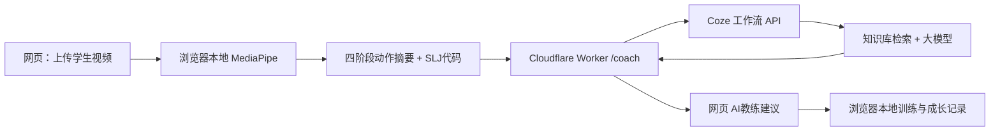

# 《跃动未来》Coze 网页接口部署与联调手册

本项目目前已上线的网页采用 **React/Vite + GitHub Pages**。Coze 在本方案中负责 AI运动教练推理与知识库检索；**GitHub Pages 不支持服务端 Token 保管**，因此采用 Cloudflare Worker 作为最小 HTTPS 代理。

> 提醒：仓库中的接口代码与知识库文件可以提前完成；在 Coze 创建并发布真实工作流之前，不能宣称已接入 Coze。当前仍有本地规则指导作为基础功能。

## 1. 系统数据流与职责



不向 Coze 上传：原视频、姓名、学号、人体关键点序列、视频文件 URL、学生健康隐私及本地成长档案。

## 2. Coze 工作流创建

1. 登录 [Coze 中国区](https://www.coze.cn/) 并选择已有工作空间。
2. 创建一个独立工作流，名称建议 **跃动未来-运动教练-诊断指导-V1**，照 `coze/WORKFLOW.md` 配置。
3. 新建文本知识库，上传 `coze/knowledge/` 下四个 Markdown 文档，按章节分段，混合检索、召回 4 段作为起点。
4. 创建四个节点：开始 → 知识库检索 → 大模型 → 结束。
5. 将 `coze/prompt/运动教练系统提示词.md` 复制到大模型的系统指令。
6. 结束节点只暴露一个名为 `answer` 的 String 字段。
7. 执行 `coze/WORKFLOW.md` 中的七组测试，检查工作流日志。
8. **发布工作流到 API**；复制真实 Workflow ID（不是 Bot ID，也不是空间 ID）。
9. 在 Coze 创建有 **run** 权限的访问令牌，令牌只放到 Worker Secret，绝不要填入仓库、网页、截图或聊天。

官方执行文档：https://docs.coze.cn/developer_guides_workflow_run

### 工作流关联方式
- 如果使用空间资源库的独立工作流，仅配置 `COZE_WORKFLOW_ID`。
- 如果工作流位于 Coze 应用内部，需要按官方文档配置 `COZE_APP_ID`。
- 如果某类工作流绑定智能体变量等需要 Bot ID，配置 `COZE_BOT_ID`。
- **不要同时设置 COZE_APP_ID 和 COZE_BOT_ID**。

## 3. 发布 Cloudflare Worker 接口

项目已经提供：`coze-proxy/worker.js` 与 `coze-proxy/wrangler.toml`。

在电脑终端运行（需要 Node.js 和 Cloudflare 账号）：

```bash
cd coze-proxy
npx wrangler login
npx wrangler secret put COZE_API_TOKEN
npx wrangler deploy
```

将 `coze-proxy/wrangler.toml` 的 `COZE_WORKFLOW_ID` 填写为 **已发布工作流 ID**（该 ID 不属于密钥）；`ALLOWED_ORIGIN` 保持现有 GitHub Pages 源站：
`https://lirael123.github.io`。

如果需要设置 `COZE_APP_ID` 或 `COZE_BOT_ID`，在 Worker 环境变量中添加对应 ID（任选适用的一种）。

在正式公开使用前，应在 Cloudflare 控制台为 `/coach` 设置合理的 WAF/速率限制规则及流量预算，防止公开 API 产生意外调用费用。CORS 只限制正常浏览器的跨域访问，并不替代身份验证和限流。代码支持可选的 `COACH_LIMITER` 平台 binding。

部署后会获得形如 `https://yuedong-coze-bridge.<你的子域>.workers.dev` 的服务地址。**这里是示例格式，不能当成现成可访问地址**。

```bash
# Coze 返回是可用但未必有效的工作流时，请先在 Coze 运行日志定位
curl -X POST "https://你的实际Worker域名/coach" \
  -H "Origin: https://lirael123.github.io" \
  -H "Content-Type: application/json" \
  -d '{"question":"怎么练习落地缓冲？","issue_codes":"SLJ-04","tier":"improvement","analysis_state":"ready","evidence_text":"落地缓冲: 145度；动作提醒代码：SLJ-04"}'
```

期望返回：
```json
{"source":"coze","reply":"（来自已发布工作流的真实中文教学建议）"}
```

如果工作流未配置，接口返回 503 并给出中文错误；不会假装是 Coze 回复。GET `/health` 只返回 `configured` / `not_configured`，**不代表模型能力已经被验证**。

## 4. 将网页连接到接口

在 GitHub 仓库 **Settings → Secrets and variables → Actions → Variables** 新建：

`COACH_API_URL = https://你的真实Worker域名/coach`

这是公开的 API URL，**不是密钥**。GitHub Actions 已通过 `VITE_COACH_API_URL: ${{ vars.COACH_API_URL }}` 注入生产构建。

重新触发一次 `main` 分支构建（例如提交一条文档更新或手动 rerun 有效工作流），等待 Pages 发布成功。网页现在会把**问题代码、匿名视频阶段角度摘要、诊断状态和训练等级**发送给 Worker。

没有配置 `COACH_API_URL` 时使用本地规则建议；配置之后如果 Coze 接口报错，就明确报错，不伪装为模型生成。

## 5. 如果希望把整个网页托管到 Coze

当前 `main` 仍由 GitHub Pages 托管，**调用 Coze 不需要迁移网站**。

如果参赛要求网页本体也由 Coze 编程托管：
1. 在 Coze 编程平台创建网页应用工程，导入本仓库源码或已构建的静态资源（具体入口以账号支持的导入功能为准）。
2. 在构建环境设置非机密的 `VITE_COACH_API_URL` 为真实 Worker 地址。
3. 修改 Worker 的 `ALLOWED_ORIGIN` 为新的 Coze 网页的完整源（例如 `https://xxx.coze.site`，不要复制占位符）。
4. 重新测试上传视频、MediaPipe 模型加载、浏览器存储、跨域请求与 AI 工作流后再替换正式演示地址。
5. **不要直接将 Coze Token 写入 Coze 前端 Vite 变量。** 若使用 Coze 平台支持的服务端密钥与后端函数，可用等价服务端代理替代 Cloudflare Worker。

GitHub Pages → Cloudflare Worker → Coze 工作流是最省改动的方案；网站迁移是独立交付项，不是接入智能体的必要前提。

## 6. 正式验收清单

- [ ] Coze 知识库的四份文本上传成功，教师检查后能够检索到 SLJ-01～04。
- [ ] 工作流已发布；Coze 控制台七组测试通过。
- [ ] Worker 的 API Token Secret 与 Workflow ID 已配置，无密钥提交记录。
- [ ] Worker 设置限流规则/预算并验证错误状态。
- [ ] GitHub Actions 的 COACH_API_URL 指向真实 Worker URL。
- [ ] 无视频：返回通用建议，不谎称看过学生动作。
- [ ] 有视频：网页传输匿名动作摘要，Coze 给出分层练习与安全提示。
- [ ] Coze 故障：明确显示错误，不出现虚假的 AI 回复。
- [ ] 练习打卡及成长记录继续保留在浏览器，不被模型修改。
- [ ] 桌面 Chrome 与 iPhone Safari 全流程验收、视频录屏通过。
