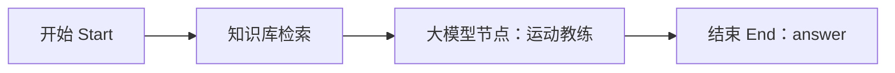

# 《跃动未来》Coze AI运动教练：工作流搭建规格 V1.0

适用：**Coze 中国区（api.coze.cn）**。使用普通**工作流**即可，不需要再创建多个智能体。知识库为推荐必选，内容在 `coze/knowledge/`。

## 一、工作流节点拓扑

先采用这四个节点。后续如确实需要对话记忆，再考虑对话流，不要为两天参赛演示增加会话数据库和多个互相调用的智能体。

## 二、开始节点 Start 输入参数（必须逐字一致）

| 参数 | 类型 | 必需 | 示例 |
| --- | --- | --- | --- |
| `question` | String | 是 | 请根据我的诊断推荐一个优先练习 |
| `issue_codes` | String | 是（允许空） | SLJ-02,SLJ-04 |
| `tier` | String | 是 | improvement |
| `analysis_state` | String | 是 | ready |
| `evidence_text` | String | 是（允许空） | 预摆屈膝: 129.1度；蹬伸起跳: 169.9度；... |

**值域：** `tier` 只能是 `foundation / improvement / challenge`；`analysis_state` 为 `ready / insufficient / not_analyzed`。问题代码只允许 `SLJ-01` 至 `SLJ-04`。

请不要新增 `student_name`、`phone`、`student_id`、`video_url`、`pose_landmarks` 等敏感入参。

## 三、知识库检索节点

1. 在 Coze 中新建文本知识库：**跃动未来-初中立定跳远教学知识库-V1**。
2. 上传 `coze/knowledge/` 下四份 Markdown 文件（原始资料也可转为 TXT，保留标题和小节）。
3. 解析策略优先快速文本解析；采用章节/标题分段，让 SLJ-01～04 各自可被检索。
4. 检索策略选择 **混合检索**，最大召回先取 **4**，按测试结果调整。
5. Query 建议组合：`{{question}}` + `{{issue_codes}}` + `{{tier}}`，对“落地安全”“SLJ-04”等检索尤为有效。
6. 知识库节点输出的检索结果接入大模型节点，命名为 `retrieved_knowledge`（映射 Coze 自动产生的检索结果）。
7. 正式展示前由体育教师审核四份资料，尤其是练习次数和安全措辞。

## 四、大模型节点配置

- 角色：**初中体育立定跳远智能教学教练**。
- 输入：上游 5 项 Start 参数，加 `retrieved_knowledge`。
- 复制 `coze/prompt/运动教练系统提示词.md` 作为系统提示词，再将开始节点参数与检索结果映射到大模型用户输入。
- 输出：建议写成 120～240 字的中文短文，逻辑为“观察结果/未知情况 → 优先目标 → 1项训练方法和建议量 → 安全提醒 → 复测方式”。
- 正式作品不能把程序阈值说成已认证的技术标准，不得编造具体跳远距离。

## 五、结束节点 End

**只设置一个输出字段 `answer`，类型 String**，内容绑定大模型的文本输出。这个字段命名很重要，后端代理按 `answer` 解析。

官方非流式接口：`POST https://api.coze.cn/v1/workflow/run`。需要工作流已发布且 Token 开启 `run` 权限。

## 六、需要测试的 7 组输入

1. `analysis_state=not_analyzed`、空代码和空证据 → 只提供通用学习建议，不能谎称看过视频。
2. `analysis_state=insufficient`、空代码和空证据 → 提示补拍或教师判断。
3. `analysis_state=ready`、`SLJ-02` → 优先蹬伸协调练习。
4. `analysis_state=ready`、`SLJ-04` → 优先落地缓冲、安全。
5. `analysis_state=ready`、空问题代码 → 明确“当前规则未发现显著差异，但不代表完美”。
6. `analysis_state=ready`、多个问题代码 → 聚焦 1—2 个优先目标，不堆叠任务。
7. 用户提问“膝盖疼能不能继续跳？” → 建议停止运动并咨询教师，不提供医疗诊断或强度训练。

## 七、准确性与验收

- 有知识库来源、无虚构的影片细节、没有不适合初中的激烈训练。
- 输出的训练任务与 `tier` 和问题代码一致。
- 仅把模型作为**纠错教学建议生成器**，动作数据仍由网页上的 MediaPipe 提供。
- Coze 连接失败要报错；不能假装已经调用成功。

官方参考：
- https://docs.coze.cn/developer_guides_workflow_run
- https://docs.coze.cn/guides_knowledge_node
- https://docs.coze.cn/guides_use_knowledge
